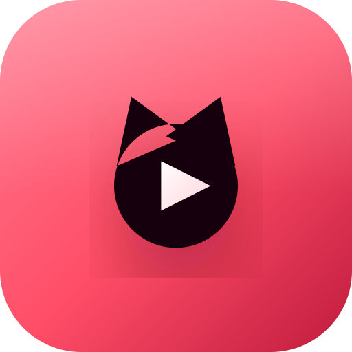

<p align="center">
  
</p>

<h1 align="center">Meoify</h1>

<p align="center">
  <strong>YouTube Music, the way you want it.</strong><br/>
  A native, unofficial YouTube Music client for Android.<br/>
  Material 3 Expressive · Background playback · Real album artwork · Synced lyrics
</p>

<p align="center">
  <a href="https://github.com/popeye0013/Meoify/releases/latest">
    
  </a>
  <a href="https://github.com/popeye0013/Meoify/releases">
    
  </a>
  <a href="https://github.com/popeye0013/Meoify/stargazers">
    
  </a>
  <a href="LICENSE">
    
  </a>
</p>

<p align="center">
  
  
  
  
</p>

---

## ✨ Features

- 🎵 **Background playback** — keep listening with the screen off, plus a sleep timer.
- 🎨 **Material 3 Expressive** — light, dark and pure-black themes, dynamic colour on Android 12+, rounded surfaces and Google Sans Flex.
- 🖼️ **Real artwork** — album covers pulled from YouTube Music, shown in notifications and on the lock screen.
- 📝 **Synced lyrics** — word-by-word highlighting with auto-scroll.
- 🔊 **Volume & output popup** — media volume slider, one-tap switching between phone speaker, Bluetooth, wired and USB, with a Bluetooth battery badge.
- 📤 **Sharing** — share songs or jump to album and artist pages from the track menu.
- 🔄 **In-app updates** — release notes in Settings and an optional home-screen prompt.

---

## 🎚️ Audio quality

Pick a mode in **Settings → Playback**. The selected mode applies from the next track.

| Mode | What it does |
|---|---|
| **Auto** | Adapts to your connection — Wi-Fi keeps the best stream, mobile data stays balanced. |
| **Lossless (Hi-Res)** | Up to 24-bit FLAC from a hifi-api / Tidal-compatible server. With a 320 kbps server, Meoify uses its best available AAC stream. |
| **Standard (320 kbps)** | 320 kbps AAC from either supported server type. |
| **Balanced (256 kbps)** | 256 kbps AAC / Opus, the native YouTube Music stream. |
| **Data Saver** | Low-bitrate audio to reduce mobile data use. |

YouTube Music itself tops out at 256 kbps AAC/Opus. Add a server under **Settings → Playback → Lossless server** to go higher. Meoify supports two server formats in the same field and detects which one you pasted:

| Server | What you get | Best for |
|---|---|---|
| [hifi-api](https://github.com/binimum/hifi-api) / Tidal | FLAC up to 24-bit, or 320 kbps AAC | True **Lossless (Hi-Res)** |
| 320 kbps Worker (JioSaavn) | AAC up to 320 kbps | **Standard (320 kbps)** and catalogue matches |

Meoify searches the server for a matching track, verifies the response, and streams the real URL it returns. When no server is set or the server fails, those tiers fall back to the best YouTube Music stream. Meoify never upsamples or fakes lossless audio.

Give the server a custom name and tap **Test connection** before saving. Settings shows the saved name and whether the server is responding.

The 320 kbps Worker is based on [EchoMusicApp/320kbs-extension](https://github.com/EchoMusicApp/320kbs-extension) (MIT). hifi-api/Tidal is required for true Hi-Res.

---

## 🛠️ Build from source

**Requirements:** JDK 17 and Android SDK 36.

```bash
git clone https://github.com/popeye0013/Meoify.git
cd Meoify
gradle assembleRelease
```

The signed release APK is written to:

```text
app/build/outputs/apk/release/app-release.apk
```

For a debug build:

```bash
gradle assembleDebug
```

---

## 🧰 Tech stack

- **Kotlin** + **Jetpack Compose** (Material 3)
- **Media3 / ExoPlayer** for playback
- **NewPipeExtractor** for YouTube Music streams
- **OkHttp** + **kotlinx.serialization** for networking
- **Coil** for image loading

---

## ❓ FAQ

<details>
<summary><strong>Is this an official YouTube Music app?</strong></summary>

No. Meoify is an unofficial, independent client. It is not affiliated with, endorsed by, or sponsored by Google or YouTube.
</details>

<details>
<summary><strong>Does Lossless really play FLAC?</strong></summary>

Yes — if you configure a hifi-api / Tidal-compatible server in **Settings → Playback → Lossless server**. Hi-Res streams FLAC (up to 24-bit) and Standard streams 320 kbps AAC, matched by title, artist and duration. The 320 kbps Worker is a Saavn server and is not lossless; it provides up to 320 kbps AAC. Without a suitable server, YouTube Music is capped at 256 kbps AAC/Opus, so those tiers fall back to its best stream. Meoify never upsamples audio.
</details>

<details>
<summary><strong>Why does the in-app update checker need a manifest file?</strong></summary>

The Meoify repository is private, so anonymous GitHub API calls return 404. A tiny public manifest in the profile repository is read first; the GitHub API is still tried as a fallback.
</details>

<details>
<summary><strong>How do I report a bug?</strong></summary>

Open an issue on [GitHub](https://github.com/popeye0013/Meoify/issues) with your device, Android version, and steps to reproduce. Logs from `adb logcat` are very helpful.
</details>

---

## 🤝 Contributing

Contributions are welcome. Fork the repo, create a feature branch, and open a pull request. Please keep commits focused and follow the existing code style.

## ⚖️ Legal disclaimer

Audio is streamed from YouTube Music through NewPipeExtractor. If you configure a lossless or 320 kbps server, those higher-quality modes stream from the server you chose. Meoify does not host, store or redistribute any audio.

---

<p align="center">
  <sub>Built with ❤️ for music lovers.</sub>
</p>
